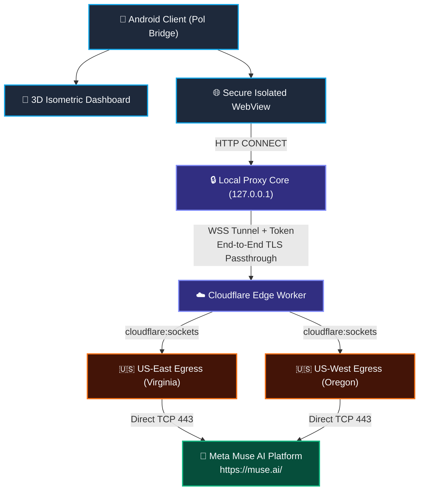

<div align="center">

# 🌉 Pol Cloudflare Bridge
### High-Performance US-Egress TLS-over-WebSocket Tunnel for Meta Muse AI
**Android Native Proxy Client · Cloudflare Workers Edge · 3D Isometric UI**

<br/>

<a href="https://github.com/imgutss/pol-cloudflare-bridge/releases/download/v1.0.0/Pol-Cloudflare-Bridge.apk">
  
</a>
<a href="./README_FA.md">
  
</a>
<a href="https://github.com/imgutss/pol-cloudflare-bridge/stargazers">
  
</a>

<br/><br/>


<a href="https://github.com/imgutss/pol-cloudflare-bridge/actions/workflows/ci.yml">
  
</a>


<br/><br/>

<a href="#faq"></a>

</div>

---

## 🌟 Overview

**Pol Cloudflare Bridge** is an open-source, privacy-first Android client and Cloudflare Workers edge tunnel engineered to provide clean, unrestricted US-egress access to **[Meta Muse AI](https://muse.ai/)** without relying on battery-draining or blacklisted public VPNs.

### ✨ Key Features

| Feature | Description |
| :--- | :--- |
| 🇺🇸 **Clean US Egress** | Direct exit through Virginia (`us-east-1`) and Oregon POPs, eliminating Meta geo-blocks. |
| 🔒 **End-to-End Encryption** | Raw `TLS 1.3` stream passthrough via `cloudflare:sockets`. The worker cannot inspect traffic. |
| ⚡ **App-Level Isolation** | Only the internal secure browser is proxied; your device stays at full network speed. |
| 🎨 **Tactile 3D UI** | Hardware-accelerated isometric dark theme with zero jitter on mobile touch screens. |
| 🤖 **Smart Login Assist** | Auto-detects official Meta Muse login forms and securely pre-fills credentials. |

---

## 🏗️ System Architecture



---

## 🚀 Download & Installation

| Release | Size | Requirements | Download Link |
| :---: | :---: | :---: | :---: |
| **v1.0.0 (Latest)** | ~1.4 MB | Android 8.0 - 15 | [📥 **Download Pol-Cloudflare-Bridge.apk**](https://github.com/imgutss/pol-cloudflare-bridge/releases/download/v1.0.0/Pol-Cloudflare-Bridge.apk) |

> 📦 View all releases and changelogs on the [Releases Page](https://github.com/imgutss/pol-cloudflare-bridge/releases).

---

## 🛠️ Deploy Your Own Edge Worker (Optional)

The edge worker source is located in the `worker/` directory and deploys to your personal Cloudflare account in 60 seconds:

```bash
cd worker
npm install
npx wrangler secret put BRIDGE_TOKEN   # Enter your custom secret token
npx wrangler deploy
```

Once deployed, enter your worker domain (`https://your-worker.workers.dev`) and token into the app's manual settings.

---

<span id="faq"></span>

## ❓ Frequently Asked Questions (FAQ)

<details>
<summary><b>Can Cloudflare Workers see my passwords or chat data?</b></summary>
<br/>
<b>No.</b> Traffic uses end-to-end TLS encryption. Encryption keys exist strictly between your Android browser and Meta's servers. The worker only relays raw encrypted bytes.
</details>

<details>
<summary><b>What caused the previous HTTP 401 error?</b></summary>
<br/>
Meta recently restricted their legacy <code>/access</code> endpoint. This updated release points to the public, active landing and login root at <code>https://muse.ai/</code> (HTTP 200 OK).
</details>

<details>
<summary><b>Is it free to use?</b></summary>
<br/>
<b>Yes, 100% free.</b> Cloudflare Workers provides 100,000 free requests daily on their free tier, which is more than enough for daily personal AI usage.
</details>

---

## 🇮🇷 راهنمای فارسی (Persian Documentation)

برای مطالعه مستندات و راهنمای کامل فارسی، می‌توانید به [**راهنمای فارسی (README_FA.md)**](./README_FA.md) مراجعه کنید یا بخش زیر را باز نمایید:

<details>
<summary><b>برای باز کردن راهنمای سریع فارسی کلیک کنید</b></summary>
<br/>

<div dir="rtl">

### 🌟 معرفی به زبان فارسی
**پل کلودفلر** یک کلاینت سبک و تخصصی اندروید است که به جای کند کردن تمام اینترنت گوشی با VPN، یک تونل مستقیم و امن بر بستر وب‌سوکت و ورکر کلودفلر در آمریکا ایجاد می‌کند تا بدون تحریم و خطای ۴۰۱ به **Meta Muse** متصل شوید.

<div align="right">

| ستون توضیح | ستون ویژگی |
| :--- | ---: |
| خروجی مستقیم از دیتاسنترهای آمریکا بدون بلاک آی‌پی | 🇺🇸 **آی‌پی تمیز آمریکا** |
| انتقال مستقیم پروتکل بدون امکان شنود سرور واسط | 🔒 **رمزنگاری کامل TLS** |
| فقط مرورگر برنامه پروکسی می‌شود و مصرف باتری ندارد | ⚡ **سبک و بدون افت سرعت** |
| طراحی سه‌بعدی با انیمیشن روان و تم نئون تاریک | 🎨 **رابط کاربری مدرن** |

</div>

<br/>

* 📥 **دانلود نسخه نهایی:** [Pol-Cloudflare-Bridge.apk](https://github.com/imgutss/pol-cloudflare-bridge/releases/download/v1.0.0/Pol-Cloudflare-Bridge.apk)

</div>

</details>

---

<div align="center">

**Crafted by [Guts (imgutss)](https://github.com/imgutss)** • *Released under the MIT License*

<br/>

[Contributing](./CONTRIBUTING.md) • [Security Policy](./SECURITY.md) • [Changelog](./CHANGELOG.md) • [Code of Conduct](./CODE_OF_CONDUCT.md)

<br/><br/>

<a href="https://github.com/imgutss/pol-cloudflare-bridge">
  
</a>

</div>
