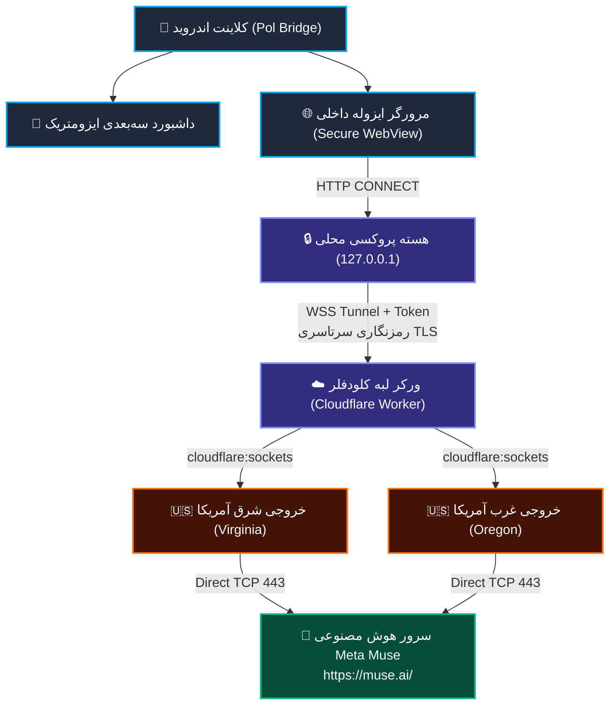

<div align="center">

# 🌉 پل کلودفلر · Pol Cloudflare Bridge
### تونل امن و پرسرعت WebSocket با خروجی آمریکا برای دسترسی به Meta Muse AI
**Android Native Proxy Client · Cloudflare Workers Edge · 3D Isometric UI**

<br/>

<a href="https://github.com/imgutss/pol-cloudflare-bridge/releases/download/v1.0.0/Pol-Cloudflare-Bridge.apk">
  
</a>
<a href="https://github.com/imgutss/pol-cloudflare-bridge/stargazers">
  
</a>

<br/><br/>


<br/><br/>

<a href="#about"></a>
<a href="#download"></a>
<a href="#architecture"></a>
<a href="#self-host"></a>
<a href="#faq"></a>

</div>

---

<span id="about"></span>

## 🌟 معرفی سریع

**پل کلودفلر (Pol Cloudflare Bridge)** کلاینت اختصاصی اندروید و تونل لبهٔ شبکه برای عبور از تحریم‌های منطقه‌ای و ورود مستقیم به هوش مصنوعی **[Meta Muse](https://muse.ai/)** بدون نیاز به VPN عمومی است.

| ویژگی | توضیح |
| :--- | :--- |
| 🇺🇸 **خروجی خالص آمریکا** | خروجی مستقیم از دیتاسنترهای ویرجینیا و اورگان جهت دور زدن قطعی تحریم متا |
| 🔒 **رمزنگاری انتها‌به‌انتها** | انتقال دست‌نخوردهٔ `TLS 1.3` (کلودفلر فقط حامل بایت‌هاست و محتوا را نمی‌بیند) |
| ⚡ **تونل در سطح برنامه** | بدون تغییر ترافیک کل گوشی؛ مصرف باتری ناچیز و سرعت پینگ بالا |
| 🎨 **رابط سه‌بعدی نئون** | طراحی ایزومتریک روان، تم تاریک بدون لگ و لرزش در اسکرول لمسی |
| 🤖 **دستیار هوشمند ورود** | شناسایی خودکار فرم ورود Muse و تکمیل ایمیل |

---

<span id="architecture"></span>

## 🏗️ معماری شبکه (دیاگرام شاخه‌ای)



---

<span id="download"></span>

## 🚀 دانلود و نصب

| نسخه | حجم | پیش‌نیاز | لینک مستقیم |
| :---: | :---: | :---: | :---: |
| **v1.0.0 (رسمی)** | ۱.۴ مگابایت | اندروید ۸ تا ۱۵ | [📥 **دانلود مستقیم فایل APK**](https://github.com/imgutss/pol-cloudflare-bridge/releases/download/v1.0.0/Pol-Cloudflare-Bridge.apk) |

> 💡 همچنین می‌توانید تمامی بیلدهای منتشرشده را در [بخش Releases مخزن](https://github.com/imgutss/pol-cloudflare-bridge/releases) مشاهده فرمایید.

---

<span id="self-host"></span>

## 🛠️ راه‌اندازی ورکر شخصی (اختیاری)

کد ورکر داخل پوشهٔ `worker/` قرار دارد و در ۶۰ ثانیه روی اکانت رایگان کلودفلر شما مستقر می‌شود:

```bash
cd worker
npm install
npx wrangler secret put BRIDGE_TOKEN   # کلید دلخواه خود را وارد کنید
npx wrangler deploy
```

سپس آدرس ورکر (`https://your-worker.workers.dev`) و توکن خود را در اپلیکیشن وارد کنید.

---

<span id="faq"></span>

## ❓ پرسش‌های متداول

<details>
<summary><b>آیا ورکر اطلاعات یا رمز عبور من را می‌بیند؟</b></summary>
<br/>
<b>خیر.</b> تمام ارتباط با پروتکل TLS رمزگذاری می‌شود. کلیدهای رمزگشایی فقط در مرورگر گوشی شما و سرور متا معتبر است.
</details>

<details>
<summary><b>دلیل ارور ۴۰۱ قبلی چه بود؟</b></summary>
<br/>
متا اندپوینت قدیمی <code>/access</code> را خصوصی کرده بود. در این نسخه مقصد به آدرس اصلی و عمومی <code>https://muse.ai/</code> تغییر یافت که با HTTP 200 در دسترس است.
</details>

<details>
<summary><b>آیا هزینه دارد؟</b></summary>
<br/>
<b>خیر، ۱۰۰٪ رایگان.</b> پلان استاندارد کلودفلر روزانه ۱۰۰ هزار درخواست رایگان ارائه می‌دهد.
</details>

---

<div align="center">

**توسعه‌داده‌شده توسط [Guts (imgutss)](https://github.com/imgutss)** • *مجوز متن‌باز MIT*

<br/>

<a href="https://github.com/imgutss/pol-cloudflare-bridge">
  
</a>

</div>
