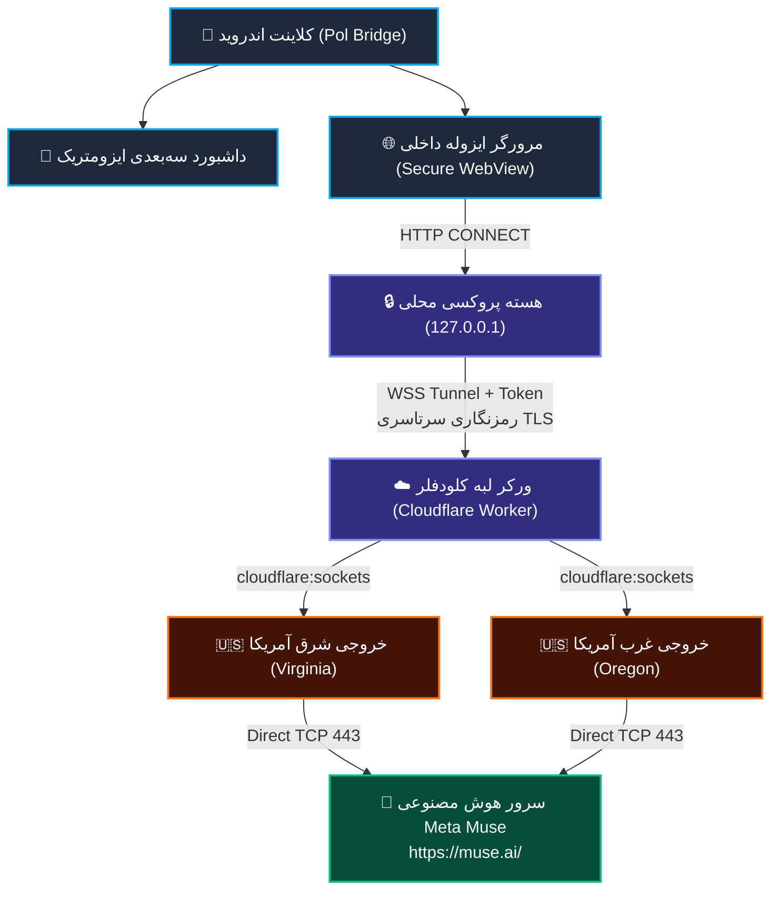

<div align="center">

# 🌉 پل کلودفلر · Pol Cloudflare Bridge
### تونل امن و پرسرعت WebSocket با خروجی آمریکا برای دسترسی به Meta Muse AI
**کلاینت اختصاصی اندروید · پردازش لبه‌ای کلودفلر · رابط کاربری سه‌بعدی**

<br/>

<a href="https://github.com/imgutss/pol-cloudflare-bridge/releases/download/v1.0.0/Pol-Cloudflare-Bridge.apk">
  
</a>
<a href="./README.md">
  
</a>
<a href="https://github.com/imgutss/pol-cloudflare-bridge/stargazers">
  
</a>

<br/><br/>


</div>

---

<div dir="rtl">

## 🌟 معرفی

**پل کلودفلر (Pol Cloudflare Bridge)** یک راهکار اختصاصی و امن برای عبور از تحریم‌های منطقه‌ای و اتصال مستقیم به سرویس هوش مصنوعی **[Meta Muse](https://muse.ai/)** بدون نیاز به فیلترشکن‌های عمومی است.

<table width="100%">
  <thead>
    <tr>
      <th align="right" width="30%">ویژگی</th>
      <th align="right" width="70%">توضیحات</th>
    </tr>
  </thead>
  <tbody>
    <tr>
      <td align="right"><b>🇺🇸 خروجی خالص آمریکا</b></td>
      <td align="right">خروجی مستقیم از دیتاسنترهای ویرجینیا و اورگان جهت دور زدن قطعی تحریم‌های هوش مصنوعی متا.</td>
    </tr>
    <tr>
      <td align="right"><b>🔒 رمزنگاری انتها‌به‌انتها</b></td>
      <td align="right">انتقال دست‌نخوردهٔ TLS 1.3 (کلودفلر فقط حامل بایت‌هاست و به محتوا دسترسی ندارد).</td>
    </tr>
    <tr>
      <td align="right"><b>⚡ بدون افت سرعت گوشی</b></td>
      <td align="right">تونل فقط برای مرورگر داخلی فعال است و ترافیک کلی گوشی و باتری را درگیر نمی‌کند.</td>
    </tr>
    <tr>
      <td align="right"><b>🎨 رابط کاربری سه‌بعدی</b></td>
      <td align="right">طراحی ایزومتریک با شتاب‌دهندهٔ سخت‌افزاری و تم تاریک بدون لرزش در اسکرول لمسی.</td>
    </tr>
    <tr>
      <td align="right"><b>🤖 دستیار هوشمند ورود</b></td>
      <td align="right">شناسایی خودکار فرم ورود Muse و تکمیل ایمیل کاربر بدون ذخیره رمز.</td>
    </tr>
  </tbody>
</table>

---

## 🏗️ معماری شبکه



---

## 🚀 دانلود و نصب

| نسخه | حجم | پیش‌نیاز | لینک دانلود |
| :---: | :---: | :---: | :---: |
| **v1.0.0 (رسمی)** | ۱.۴ مگابایت | اندروید ۸ تا ۱۵ | [📥 **دانلود مستقیم فایل APK**](https://github.com/imgutss/pol-cloudflare-bridge/releases/download/v1.0.0/Pol-Cloudflare-Bridge.apk) |

> 📦 جهت مشاهده گزارش تغییرات یا بیلدهای گذشته می‌توانید به [صفحه Releases در گیت‌هاب](https://github.com/imgutss/pol-cloudflare-bridge/releases) مراجعه فرمایید.

---

## 🛠️ راه‌اندازی ورکر شخصی (اختیاری)

سورس ورکر در پوشهٔ `worker/` قرار دارد و به‌راحتی روی اکانت رایگان کلودفلر شما مستقر می‌شود:

```bash
cd worker
npm install
npx wrangler secret put BRIDGE_TOKEN   # کلید امنیتی دلخواه خود را وارد کنید
npx wrangler deploy
```

سپس آدرس ورکر خود (`https://your-worker.workers.dev`) و کلید تنظیم‌شده را در بخش تنظیمات دستی اپلیکیشن وارد کنید.

---

## ❓ پرسش‌های متداول

<details>
<summary><b>آیا ورکر کلودفلر اطلاعات یا رمز عبور من را می‌بیند؟</b></summary>
<br/>
<b>خیر، به هیچ وجه.</b> ترافیک دارای رمزنگاری کامل انتها‌به‌انتها (E2EE) بر بستر TLS است. کلیدهای رمزگشایی فقط درون مرورگر گوشی شما و سرور اصلی متا قرار دارند.
</details>

<details>
<summary><b>دلیل خطای ۴۰۱ قبلی چه بود؟</b></summary>
<br/>
متا اخیراً اندپوینت منسوخ‌شدهٔ <code>/access</code> را خصوصی کرده بود. در این نسخهٔ نهایی، آدرس مقصد به آدرس عمومی و پایدار <code>https://muse.ai/</code> تغییر یافته و پاسخ HTTP 200 دریافت می‌کند.
</details>

<details>
<summary><b>آیا استفاده از برنامه هزینه‌ای دارد؟</b></summary>
<br/>
<b>خیر، ۱۰۰٪ رایگان.</b> پلان استاندارد کلودفلر روزانه ۱۰۰ هزار درخواست رایگان ارائه می‌دهد که برای استفاده‌های شخصی کاملاً کافی است.
</details>

</div>

---

<div align="center">

**توسعه‌داده‌شده توسط [Guts (imgutss)](https://github.com/imgutss)** • *مجوز متن‌باز MIT*

<br/>

[راهنمای مشارکت](./CONTRIBUTING.md) • [خط‌مشی امنیت](./SECURITY.md) • [تاریخچه تغییرات](./CHANGELOG.md) • [مرام‌نامه اخلاقی](./CODE_OF_CONDUCT.md)

<br/><br/>

<a href="https://github.com/imgutss/pol-cloudflare-bridge">
  
</a>

</div>
